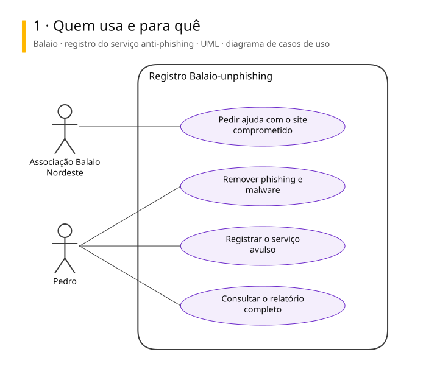
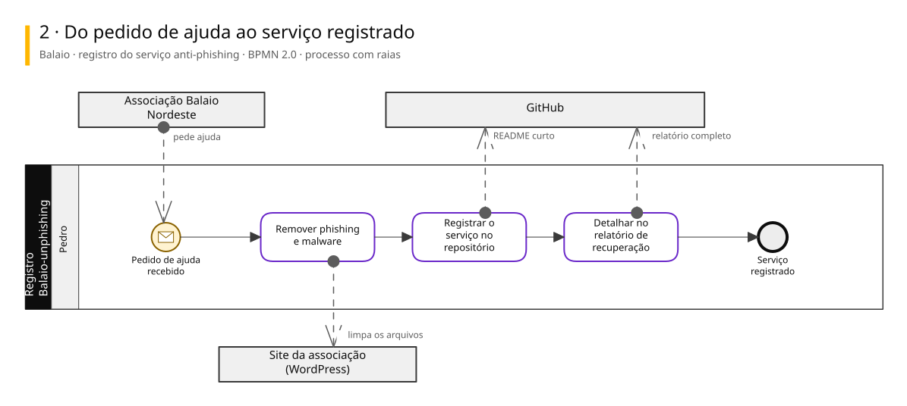
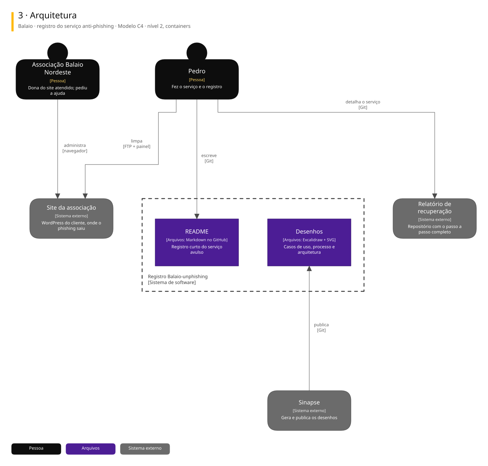

# Arquitetura

Três vistas do sistema, cada uma numa notação padrão.

| Vista | Notação | Responde |
|---|---|---|
| 1. Casos de uso | UML | Quem usa e para quê |
| 2. Processo | BPMN 2.0 | Como o trabalho anda, com uma raia para cada quem executa |
| 3. Arquitetura | C4, nível 2 | De que partes o sistema é feito e com quem conversa |

## Balaio · registro do serviço anti-phishing

Repositório de registro (Balaio-unphishing) de um serviço avulso de segurança feito em março/2025 no site da Associação Cultural Balaio Nordeste. Só tem um README curto e os desenhos; o passo a passo está no relatório de recuperação do mesmo cliente.

### 1. Quem usa e para quê

### 2. Do pedido de ajuda ao serviço registrado

### 3. Arquitetura

Para editar: [balaio.excalidraw](./balaio.excalidraw), que abre em [excalidraw.com](https://excalidraw.com) ou na extensão Excalidraw do VS Code.

## De onde vêm

Os diagramas são gerados a partir do Sinapse, o vault onde o Pedro organiza notas e projetos. Mudança feita direto aqui some na próxima publicação: o lugar de mudar é a especificação no Sinapse.
