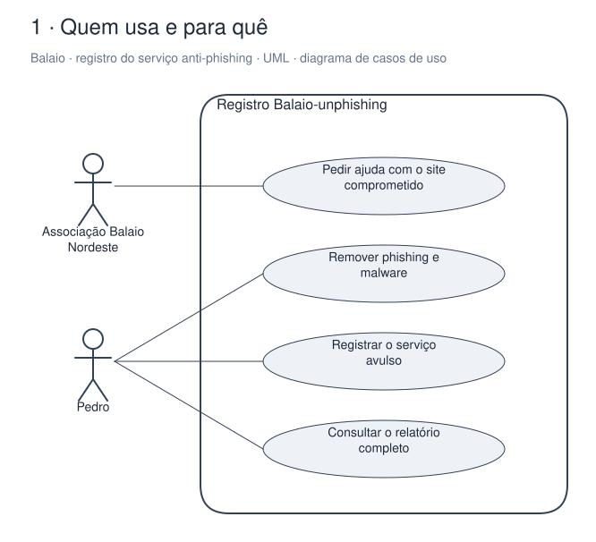
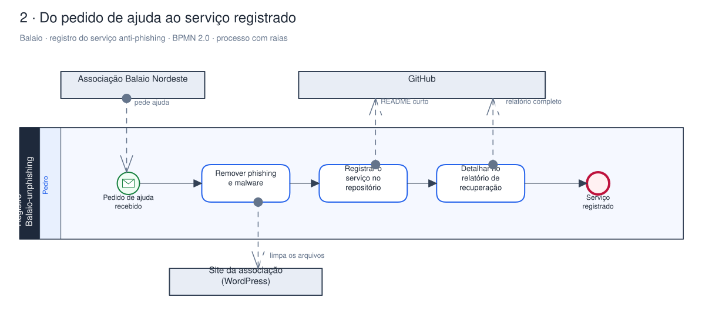
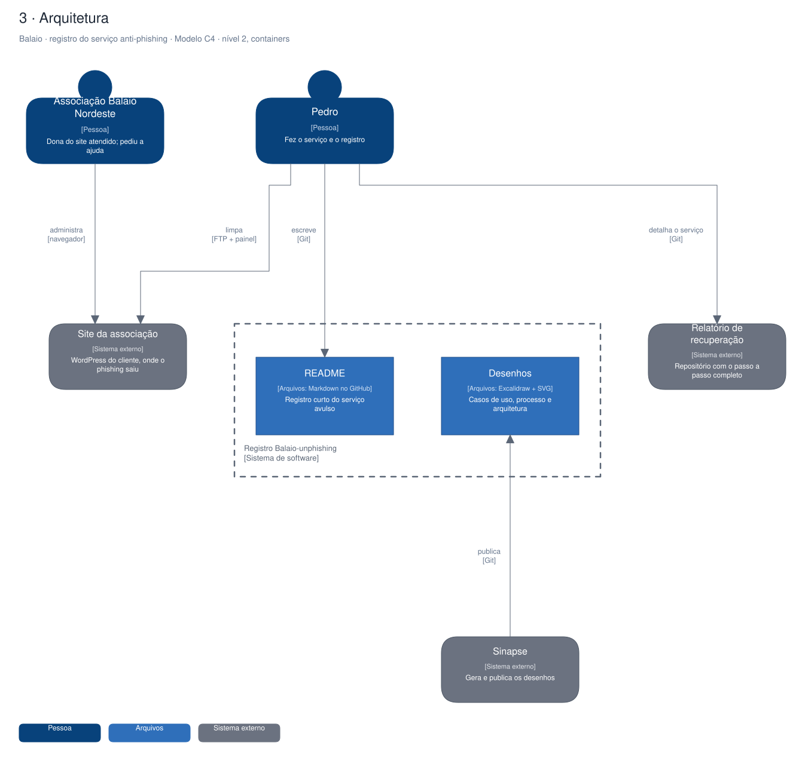

# Arquitetura

Diagramas gerados a partir do Sinapse (o segundo cérebro do Pedro). Cada projeto tem três vistas,
cada uma numa notação padrão:

1. **Quem usa e para quê**: UML, diagrama de casos de uso.
2. **O processo principal**: BPMN 2.0, com raias por quem executa.
3. **A arquitetura**: modelo C4, nível 2 (containers).

## Balaio · registro do serviço anti-phishing

Repositório de registro (Balaio-unphishing) de um serviço avulso de segurança feito em março/2025 no site da Associação Cultural Balaio Nordeste. Só tem um README curto e os desenhos; o passo a passo está no relatório de recuperação do mesmo cliente.

### Quem usa e para quê (UML)

### Do pedido de ajuda ao serviço registrado (BPMN 2.0)

### Arquitetura (C4, containers)

Editável: [`balaio-unphising.excalidraw`](./balaio-unphising.excalidraw), abre em [excalidraw.com](https://excalidraw.com) ou no VS Code com a extensão Excalidraw.

A fonte destes arquivos é o vault do Sinapse (`09-DESENHOS/`); alterações feitas aqui são sobrescritas na próxima publicação.
