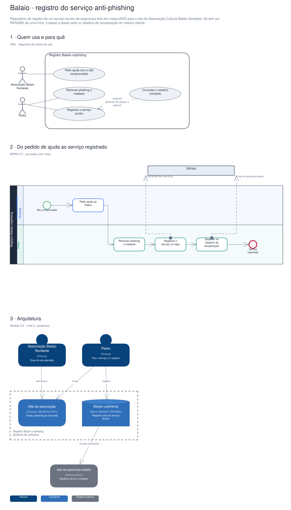

# Arquitetura

Diagramas gerados a partir do Sinapse (o segundo cérebro do Pedro). Cada projeto tem três vistas,
cada uma numa notação padrão:

1. **Quem usa e para quê**: UML, diagrama de casos de uso.
2. **O processo principal**: BPMN 2.0, com raias por quem executa.
3. **A arquitetura**: modelo C4, nível 2 (containers).

## Balaio · registro do serviço anti-phishing

Repositório de registro de um serviço avulso de segurança feito em março/2025 para o site da Associação Cultural Balaio Nordeste. Só tem um README de uma linha; o passo a passo está no relatório de recuperação do mesmo cliente.

Editável: [`balaio-unphising.excalidraw`](./balaio-unphising.excalidraw), abre em [excalidraw.com](https://excalidraw.com) ou no VS Code com a extensão Excalidraw.

A fonte destes arquivos é o vault do Sinapse (`09-DESENHOS/`); alterações feitas aqui são sobrescritas na próxima publicação.
